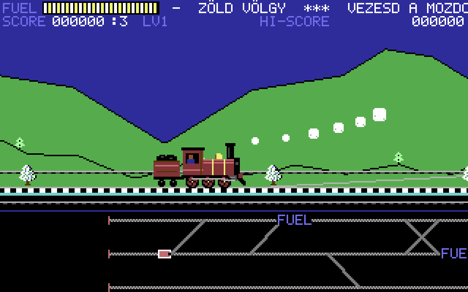

# LOCO – C64 remake (böngészős)

A klasszikus Commodore 64-es **Loco** (Alligata Software, 1984) mozdonyos lövöldözős játék rajongói remake-je, egyetlen HTML-fájlban. Minden grafika kódból rajzolt pixel-art (C64 16 színű paletta, 320×200 felbontás), a zene és a hangok WebAudio-val szintetizált, SID-stílusú saját szerzemények.

**Játék:** https://zsirafmix.github.io/loco-c64-remake/

## Cél
Vezesd a mozdonyt a váltók útvesztőjén keresztül a pálya jobb szélén lévő **állomásig**. Az alsó térképen (radar) látod a teljes vasúthálózatot, a tavakat, a FUEL ládákat és az állomást.

- Az **üzemanyag** folyamatosan fogy – gyűjtsd a FUEL ládákat.
- A **repülők, gépek és léghajók (ACE)** bombákat dobnak – lődd le őket vagy a bombákat füsttel, vagy kerüld ki gyorsítással/fékezéssel.
- A **sorompókat** és a **hajtányos embert** füsttel kell eltakarítani.
- 5 különböző pálya, utána a pályák újra jönnek, egyre nehezebben.

## Irányítás
| Billentyű | Funkció |
|---|---|
| → / D | gyorsítás |
| ← / A | fék, majd tolatás |
| ↑ / W, ↓ / S | váltó beállítása (a következő elágazásnál arra megy; a radaron sárgán villog) |
| Space / Ctrl / X | füst-lövés |
| Enter / Space | indítás / folytatás |
| P / Esc | szünet |
| M | hang ki/be |

Telefonon/tableten érintős irányítás jelenik meg (iránykereszt + FÜST gomb). Fekvő helyzetben a legjobb.

A rekord (HI-SCORE) a böngészőben elmentődik.

---
Rajongói, nem kereskedelmi remake. Az eredeti játék: Alligata Software, 1984 (zene: Ben Daglish).
